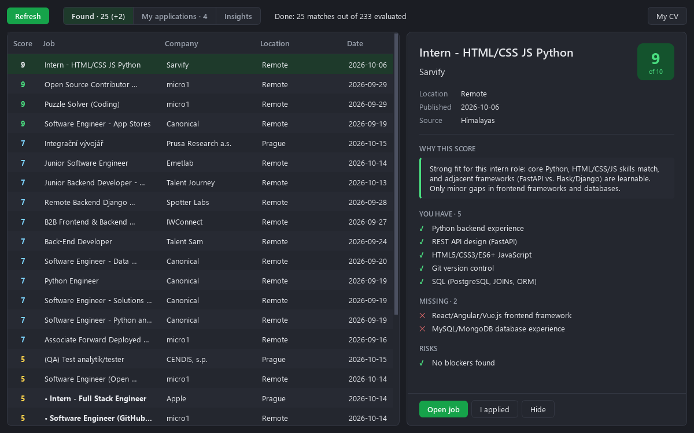
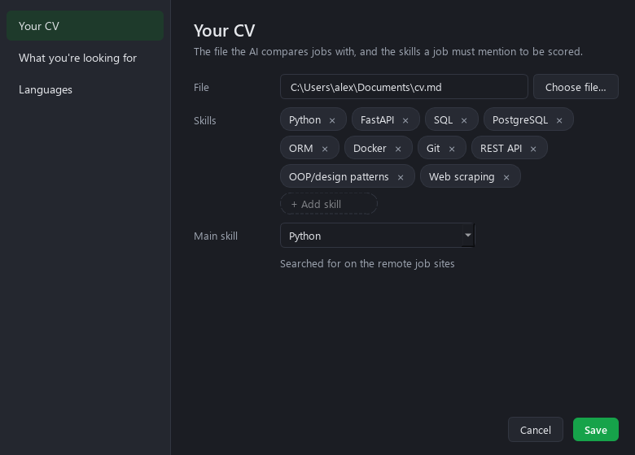

# Job Finder

A small Windows app that goes through job boards for me and tells me which jobs are actually worth
applying to.

I made it while looking for my first Python job in Prague. Checking job boards every day got old
fast: most listings want years of experience, a different stack, or an office in another city. So the
app does the first pass for me. It downloads new listings, drops the ones that have nothing to do with
my CV, and asks a local AI model to score the rest from 1 to 10 and explain the score.



## What it does

- Pulls new jobs from junior.guru, Himalayas, Jobicy and Working Nomads (all of them have open APIs).
  It looks for jobs in Czechia and remote jobs open to people in Czechia.
- Skips jobs that don't mention any of my skills, so the model doesn't waste time on them. The skills
  are found in the CV automatically and can be fixed by hand.
- Scores the rest with a model running in LM Studio on my own graphics card. For each job I get a
  score, a short reason, what I already have, what's missing and what could rule me out.
- Shows jobs with a score of 5 or more, best first. Jobs that are new since last time are marked.
- Shows how old each job really is. Job sites like to bump old listings so they look new, so the app
  remembers when it first saw a job and marks those as "reposted". There's a search box, a
  7 / 14 / 30 days filter and a "newest first" order above the list.
- Keeps track of where I applied. One click moves a job to My applications, where I can mark it
  accepted or rejected, write notes and see how long I've been waiting for an answer.
- The Insights tab counts what I'm missing most often across all jobs. Handy for deciding what to
  learn next.

Nothing leaves the computer except the requests to the job boards. The CV and the database stay on
your machine.

## Installing it

It takes about 20 minutes, most of it waiting for downloads.

### What you need

- Windows 10 or 11.
- A graphics card with at least 8 GB of video memory that LM Studio supports. The AI model runs on
  it. I use an RTX 3060 with 12 GB.
- About 8 GB of free disk space: 6 GB for the model, the rest for Python libraries.
- Your CV as a Markdown, text or PDF file. A PDF has to contain text, not a scanned picture. If your
  CV is in Word, save it as PDF.

### 1. Install Python 3.11

1. Download the Windows installer for **Python 3.11** (64-bit) from
   [python.org/downloads](https://www.python.org/downloads/windows/). It has to be 3.11: the setup
   script asks for exactly that version.
2. Run it with the default options. Leave "py launcher" checked, the setup script needs it.
3. Check it: open PowerShell and run

   ```powershell
   py -3.11 --version
   ```

   It should print `Python 3.11.something`.

### 2. Install LM Studio and download the model

1. Download and install [LM Studio](https://lmstudio.ai).
2. Open it once. On the first start it sets up its command-line tool (`lms`), which Job Finder uses to
   start the model. After that you can close it.
3. Download the model, about 6 GB. Either search for **ministral 3 8b** in LM Studio and download
   `mistralai/ministral-3-8b`, or run this in PowerShell:

   ```powershell
   & "$env:USERPROFILE\.lmstudio\bin\lms.exe" get mistralai/ministral-3-8b
   ```

You don't need to load the model or start a server yourself. Job Finder does that when it needs the
model and unloads it when it's done, so the video memory is free again.

### 3. Download Job Finder

Put it in a folder you're going to keep, for example `C:\Users\<you>\JobFinder`. The desktop shortcut
points to this folder, and your jobs and notes are saved there, so don't use Downloads or a temporary
folder.

- With Git:

  ```powershell
  git clone https://github.com/BuisnessCat/cv_job_finder.git JobFinder
  ```

- Without Git: on the GitHub page click **Code → Download ZIP** and unzip it into that folder.

### 4. Run the setup script

1. Open the folder in Explorer, right-click an empty spot and choose **Open in Terminal** (on Windows 10:
   hold Shift, right-click and choose **Open PowerShell window here**).
2. Run:

   ```powershell
   powershell -ExecutionPolicy Bypass -File install.ps1
   ```

   `-ExecutionPolicy Bypass` lets this one script run without changing any Windows settings.

The script creates a `.venv` folder with the libraries the app needs (a couple of minutes) and puts a
**Job Finder** shortcut on the desktop. When it prints `Done: a Job Finder shortcut is on the
desktop`, you're set.

### 5. First start

Open Job Finder from the shortcut. A short setup asks three things:

1. **Your CV.** Pick the file. The app finds the skills in it and shows them as chips: remove the wrong
   ones, add the missing ones. Then pick your **main skill**. Remote job boards are searched by it, so
   choose what you'd type into a job search, like Python or Java. You don't have to come up with any
   keywords.
2. **What you're looking for.** City, whether remote is fine, and your level. You can pick several
   levels, like Intern and Junior.
3. **Languages.** Every language you speak and how well. The AI checks each job's language
   requirements against them.

After **Start search** the app scores every job it found. The first time this takes a while, about
8 seconds per job on my RTX 3060, so 20–40 minutes. Jobs show up in the list as they're scored, so you
can start reading right away. Later only new jobs get scored, which is a matter of minutes.

Avoid playing games while it's scoring: the game and the model share the video memory, and scoring
gets slow or fails.

Everything from the setup can be changed later with the **Settings** button at the top of the window.
If a change affects the scores (your CV, city, levels or languages), the app tells you how long
scoring everything again will take and asks first.



### Updating

- With Git: run `git pull` in the folder, then run the setup script again.
- With a ZIP: download the new ZIP and unzip it over the old folder. Your jobs and settings are in
  `jobs.db`, which isn't in the ZIP, so they stay. Then run the setup script again.

### Uninstalling

Delete the desktop shortcut and the folder. Your jobs, applications and notes are in `jobs.db` in that
folder, so copy it somewhere first if you want to keep them. The model can be deleted in LM Studio
under My Models.

### If something goes wrong

| What you see | What to do |
|---|---|
| `Could not create .venv (Python 3.11 is required)` | Python 3.11 isn't installed, or the py launcher is missing. Go back to step 1. |
| `running scripts is disabled on this system` | You ran `.\install.ps1` directly. Use the full command from step 4. |
| `LM Studio: not found: …lms.exe` in the status line | LM Studio isn't installed or was never opened. Install it and open it once. |
| `LM Studio: model failed to load` | The model isn't downloaded, or there isn't enough free video memory. Check step 2 and close games or other heavy apps. |
| Scoring is very slow or times out | The graphics card is busy with something else. Close it and click Refresh. |
| `Himalayas: error (521 …)` or another site error | That site is down for a while. The other sites still work; click Refresh later. |
| `Job Finder is already open.` | It's already running. If you can't see it, end `pythonw.exe` in Task Manager. |
| Anything else | Look at `job_finder.log` in the folder: every error is written there with details. |

## Changing things

Everything about you is in Settings. The technical bits are in `job_finder/config.py`: the model and
what to ask the job boards for. The rules the model uses for scoring are a plain-text template in
`job_finder/llm.py`, filled in from your settings. If you change the template or your CV, all jobs get
scored again on the next refresh.

## Tests

```powershell
.venv\Scripts\python -m pytest tests -q
```

They take a few seconds and don't need internet or LM Studio.

## How it was made

I built this with Claude Code, Anthropic's coding assistant. The idea, the decisions about what the
app should do and the testing on my own job search were mine, and Claude wrote most of the code and
tests. The notes and plans from that process are in `docs/superpowers/` (in Russian), and there's a
plain explanation of how everything fits together in `docs/how-it-works.ru.md`.

## License

MIT
