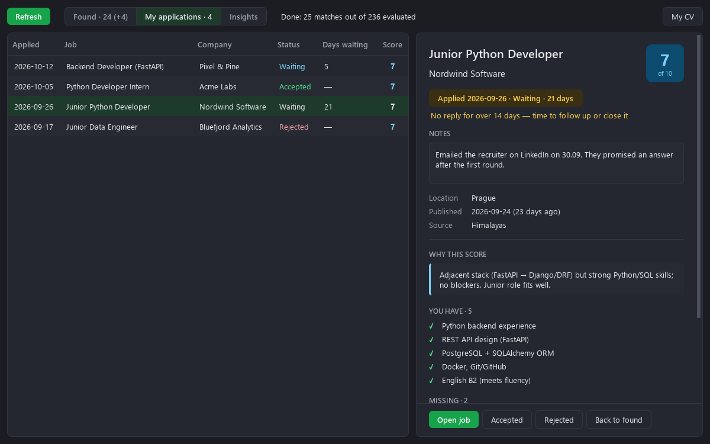
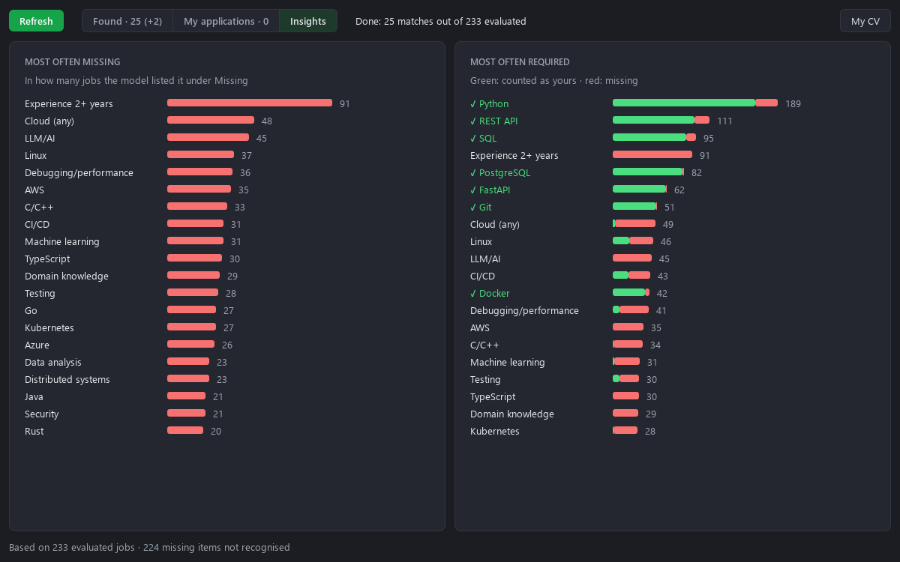
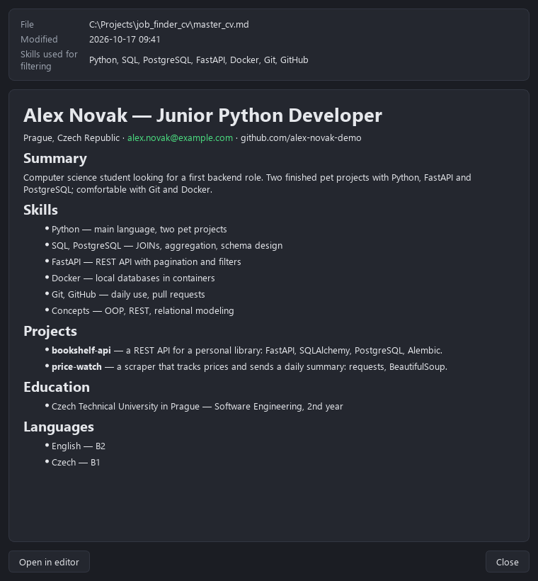

# Job Finder

A small Windows app that goes through job boards for me and tells me which jobs are actually worth
applying to.

I made it while looking for my first Python job in Prague. Checking job boards every day got old
fast: most listings want years of experience, a different stack, or an office in another city. So the
app does the first pass for me. It downloads new listings, drops the ones that have nothing to do with
my CV, and asks a local AI model to score the rest from 1 to 10 and explain the score.


## What it does

- Pulls new jobs from junior.guru, Himalayas, Jobicy and Working Nomads (all of them have open APIs).
- Skips jobs that don't mention any skill from my CV, so the model doesn't waste time on them.
- Scores the rest with a model running in LM Studio on my own graphics card. For each job I get a
  score, a short reason, what I already have, what's missing and what could rule me out.
- Shows jobs with a score of 5 or more, best first. Jobs that are new since last time are marked.
- Keeps track of where I applied. One click moves a job to My applications, where I can mark it
  accepted or rejected, write notes and see how long I've been waiting for an answer.
- The Insights tab counts what I'm missing most often across all jobs. Handy for deciding what to
  learn next.

Nothing leaves the computer except the requests to the job boards. My CV and the database stay on
my machine and are ignored by git.





## Running it yourself

You'll need Windows, Python 3.11, [LM Studio](https://lmstudio.ai) and a graphics card with about
8 GB of free memory.

1. Clone the repo:

   ```bash
   git clone https://github.com/BuisnessCat/cv_job_finder.git
   cd cv_job_finder
   ```

2. Download the model (about 6 GB):

   ```bash
   lms get mistralai/ministral-3-8b
   ```

3. Put your CV in the project folder as `master_cv.md`. Any Markdown is fine, but it needs a
   `## Skills` section with one line per group of skills, like this:

   ```markdown
   ## Skills
   - Python — main language
   - SQL, PostgreSQL — queries and schema design
   - Git, GitHub — daily use
   ```

4. Run the installer. It sets up a virtual environment and puts a Job Finder shortcut on the desktop:

   ```bash
   powershell -ExecutionPolicy Bypass -File install.ps1
   ```

5. Open Job Finder from the shortcut. The first run scores every job, so it takes a while (on my
   RTX 3060 it's about 8 seconds per job). After that only new jobs get scored.

You don't have to open LM Studio yourself. The app starts it, loads the model and unloads it when
it's done.



## Changing things

Most settings are in `job_finder/config.py`: the minimum score, after how many days to remind you
about an application, the model, and what to ask the job boards for. Right now it's set up for
Prague and remote jobs. The Prague filter for junior.guru is in `job_finder/sources.py`.

The rules the model uses for scoring are plain text in `job_finder/llm.py`. If you change them or
your CV, all jobs get scored again on the next refresh.

## Tests

```bash
.venv\Scripts\python -m pytest tests -q
```

They take a couple of seconds and don't need internet or LM Studio.

## How it was made

I built this with Claude Code, Anthropic's coding assistant. The idea, the decisions about what the
app should do and the testing on my own job search were mine, and Claude wrote most of the code and
tests. The notes and plans from that process are in `docs/superpowers/` (in Russian), and there's a
plain explanation of how everything fits together in `docs/how-it-works.ru.md`.

## License

MIT
